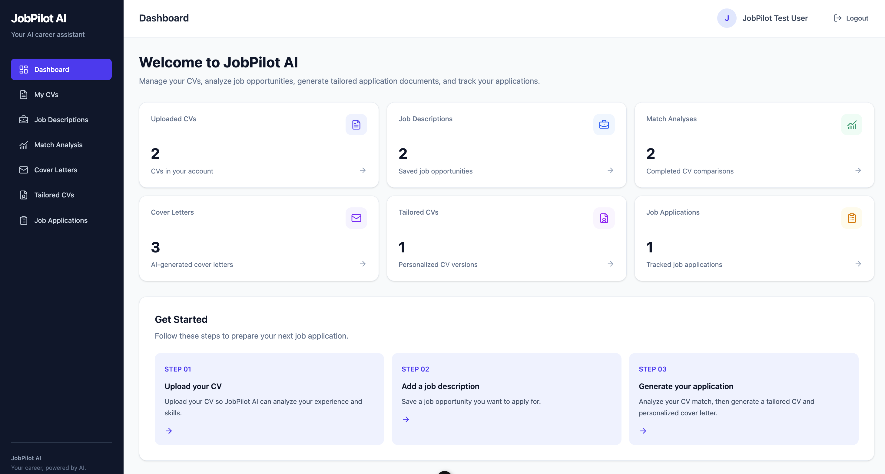
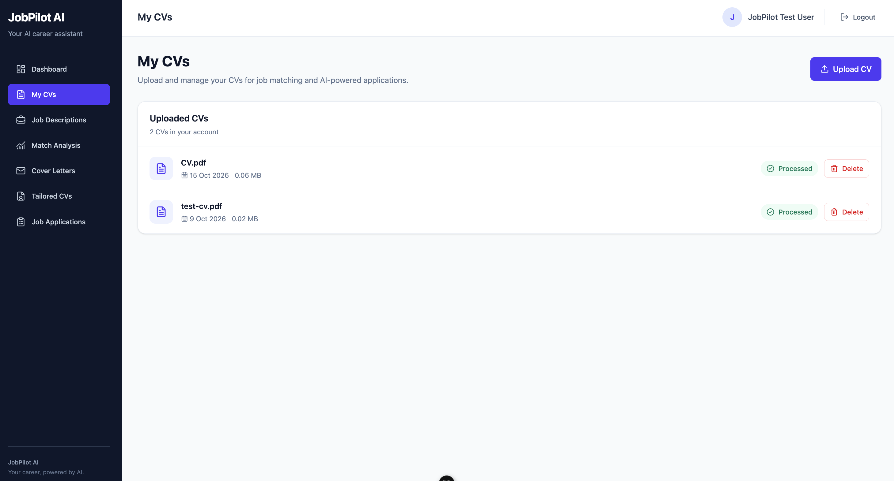
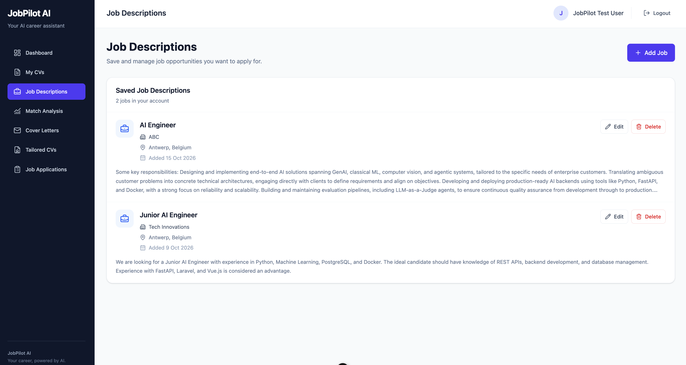
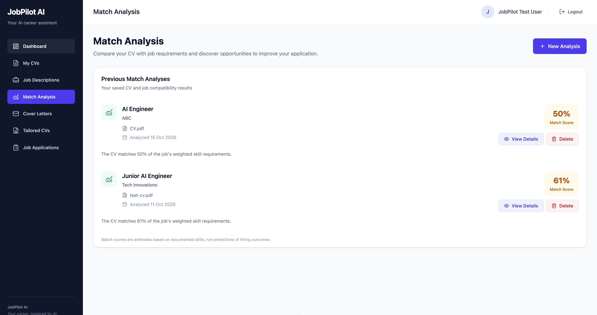
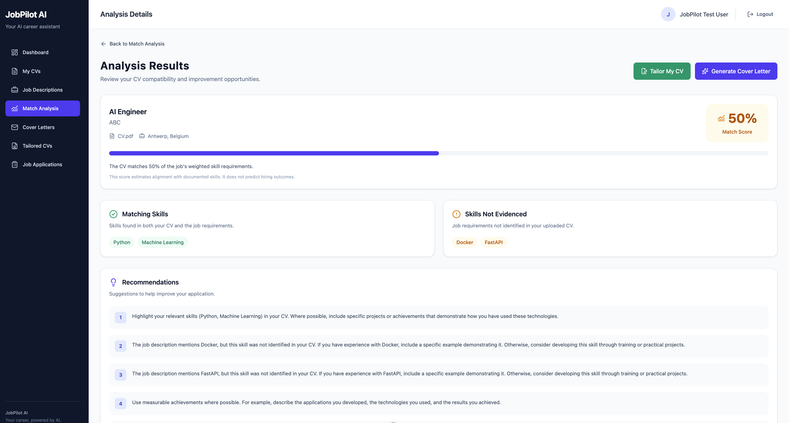
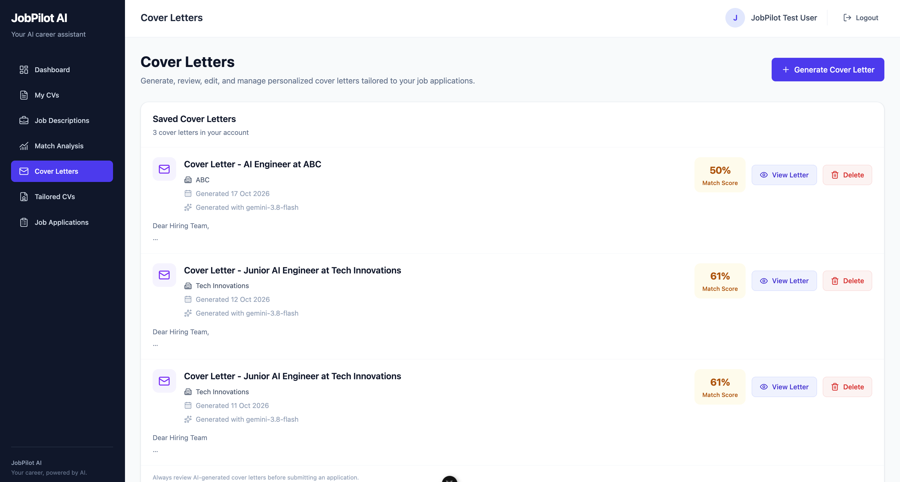
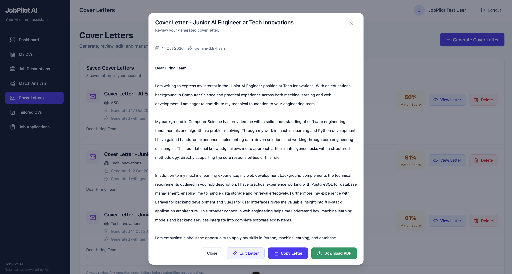
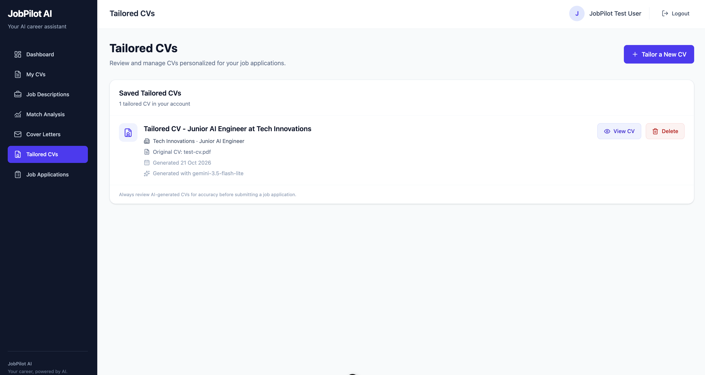
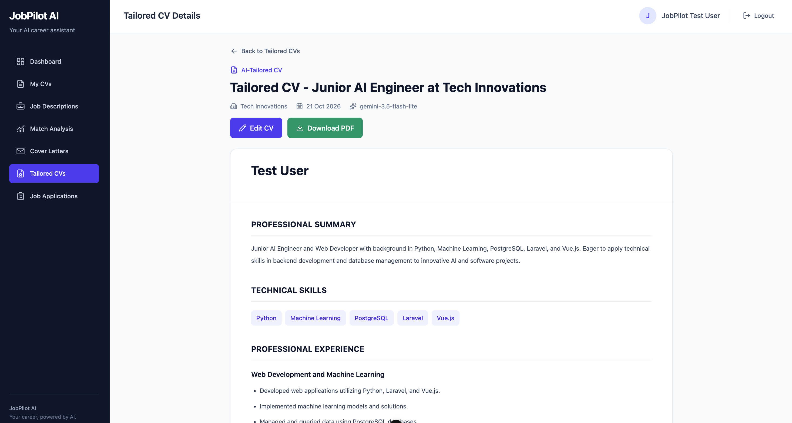
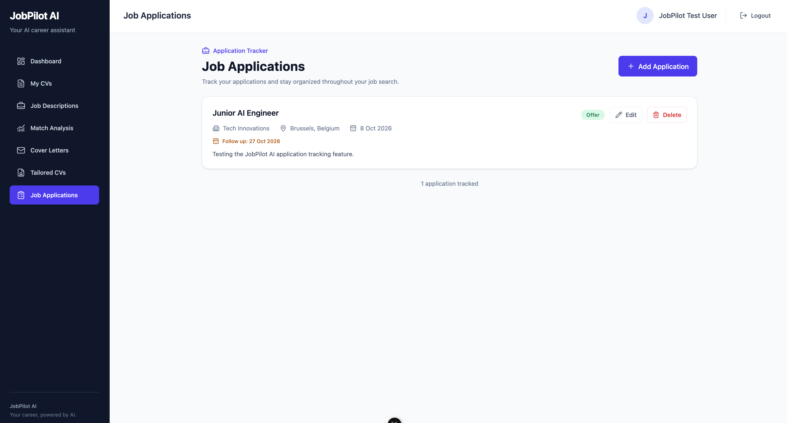

# 🚀 JobPilot AI

### Your AI-Powered Job Application Assistant

JobPilot AI is a full-stack web application designed to help job seekers streamline and improve their job application process.

By combining artificial intelligence with an intuitive interface, JobPilot AI enables users to manage their CVs, analyze job opportunities, evaluate how well their qualifications match job requirements, generate tailored application documents, and track job applications.

Built with **Laravel, Vue.js, TypeScript, FastAPI, PostgreSQL, and Google Gemini AI**.

---

## 🎥 Demo

A complete walkthrough of JobPilot AI will be available soon.

**▶ [Watch the Demo](YOUR_YOUTUBE_VIDEO_LINK)**

---

## ✨ Key Features

### 📊 Interactive Dashboard

A centralized dashboard providing an overview of uploaded CVs, saved job descriptions, completed analyses, generated documents, and tracked applications.



### 📄 CV Management

Users can upload and manage their CVs, allowing the system to extract and analyze relevant professional information.



### 💼 Job Description Management

Save job descriptions and organize opportunities for future analysis and applications.



### 🧠 AI-Powered Job Matching

JobPilot AI analyzes CVs against job descriptions using AI to identify relevant qualifications, strengths, missing skills, and potential areas for improvement.



#### Detailed Match Analysis

Explore detailed AI-generated insights to better understand how your qualifications align with a specific job opportunity.



### 📝 AI-Generated Cover Letters

Generate personalized cover letters based on your CV and the requirements of a specific job.



#### Generated Cover Letter

Preview and download AI-generated cover letters in PDF format.



### 📑 Tailored CV Generation

Create customized versions of your CV based on the skills and experience relevant to a specific job description.



#### Generated CV

Preview and download tailored CVs as PDF documents.



### 📌 Job Application Tracking

Keep track of job applications and organize your job search in one place.



---

## 🛠️ Technology Stack

| Layer | Technologies |
|---|---|
| Frontend | Vue.js 3, TypeScript, Tailwind CSS, Vite |
| Backend | Laravel 13, PHP |
| Database | PostgreSQL |
| AI Service | Python, FastAPI |
| AI Integration | Google Gemini AI |
| Authentication | Laravel Sanctum |
| PDF Processing | PyMuPDF |
| PDF Generation | Laravel Blade PDF templates |
| Version Control | Git, GitHub |

---

## 🏗️ System Architecture

JobPilot AI follows a three-service architecture:

```text
                    ┌──────────────────────────┐
                    │       Vue.js Frontend     │
                    │    TypeScript + Vite      │
                    └────────────┬─────────────┘
                                 │
                                 │ HTTP / REST API
                                 ▼
                    ┌──────────────────────────┐
                    │      Laravel Backend     │
                    │ Authentication & Business│
                    │          Logic           │
                    └────────────┬─────────────┘
                                 │
                    ┌────────────┴─────────────┐
                    │                          │
                    ▼                          ▼
          ┌───────────────────┐     ┌────────────────────┐
          │    PostgreSQL     │     │   FastAPI Service  │
          │     Database      │     │   Google Gemini AI │
          └───────────────────┘     └────────────────────┘
```

### How It Works

1. Users interact with the Vue.js frontend.
2. Laravel manages authentication, application data, and business logic.
3. PostgreSQL stores users, CV records, job descriptions, analyses, and application information.
4. Laravel communicates with the FastAPI service for AI-powered processing.
5. FastAPI uses Google Gemini to generate analyses and personalized application content.
6. Generated results are returned to the application for viewing and downloading.

---

## 📁 Project Structure

```text
JobPilotAI/
│
├── jobpilot-frontend/       # Vue.js frontend
│
├── jobpilot-api/            # Laravel backend
│
├── jobpilot-ai-service/     # FastAPI AI service
│
├── docs/
│   └── screenshots/        # Application screenshots
│
└── README.md
```

---

## ⚙️ Installation and Setup

### Prerequisites

Make sure you have the following installed:

- PHP and Composer
- Node.js and npm
- Python 3
- PostgreSQL
- A Google Gemini API key

### 1. Clone the Repository

```bash
git clone https://github.com/angemarie0112/jobpilot-ai.git

cd jobpilot-ai
```

### 2. Configure the Laravel Backend

```bash
cd jobpilot-api

composer install

cp .env.example .env

php artisan key:generate
```

Update your Laravel `.env` file with your PostgreSQL credentials and AI service configuration.

Run the database migrations:

```bash
php artisan migrate
```

Start the Laravel development server:

```bash
php artisan serve
```

The backend will typically run at:

`http://127.0.0.1:8000`

### 3. Configure the FastAPI AI Service

Open another terminal:

```bash
cd jobpilot-ai-service

python3 -m venv .venv

source .venv/bin/activate

python -m pip install -r requirements.txt
```

Create your environment configuration:

```bash
cp .env.example .env
```

Configure the following variables:

```env
GEMINI_API_KEY=your_api_key
GEMINI_MODEL=your_supported_gemini_model
GEMINI_CV_MODEL=your_supported_gemini_cv_model
```

Start the AI service:

```bash
python -m uvicorn main:app --reload --host 127.0.0.1 --port 8001
```

The AI service will run at:

`http://127.0.0.1:8001`

### 4. Configure the Vue.js Frontend

Open another terminal:

```bash
cd jobpilot-frontend

npm install

npm run dev
```

The frontend will typically run at:

`http://localhost:5173`

Make sure the frontend API URL points to your Laravel backend.

---

## 🔄 Application Workflow

```text
Create Account / Login
          ↓
       Upload CV
          ↓
   Add Job Description
          ↓
     Analyze CV Match
          ↓
   Review AI Insights
          ↓
 Generate Tailored CV
          ↓
 Generate Cover Letter
          ↓
 Download PDF Documents
          ↓
 Track Job Applications
```

---

## 🔮 Future Improvements

Potential future enhancements include:

- Automated job discovery and recommendations
- Integration with external job platforms
- AI-powered interview preparation
- Application reminders and notifications
- Advanced job search analytics
- Cloud deployment

---

## 👩‍💻 Development

JobPilot AI is a project demonstrating full-stack development, REST API integration, database design, AI integration, authentication, and document generation.

The project is designed to provide a practical solution to common challenges faced by job seekers.

---

## 📄 License

No open-source license has been added to this repository.